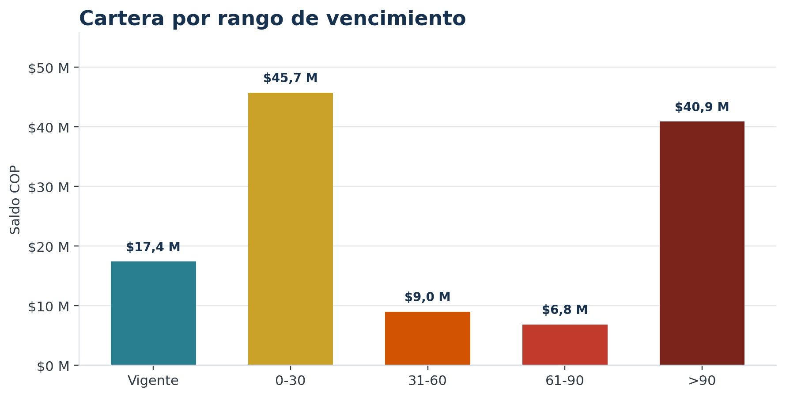
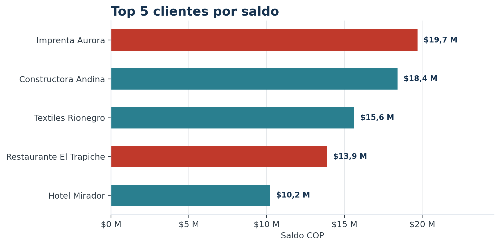
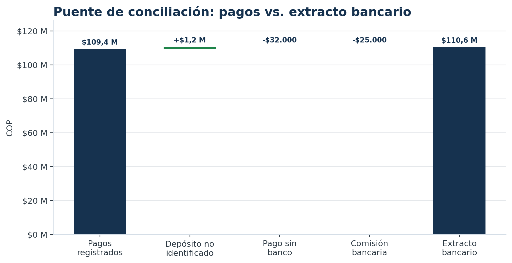

# Cartera de clientes — caso de 20 clientes

Caso práctico de **cartera y cuentas por cobrar** con datos ficticios: notas crédito y débito, aplicación de pagos, aging, cupos, conciliación bancaria y dashboard en Excel.

**Empresa ficticia:** Distribuciones Andinas S.A.S.  
**Corte:** 30/09/2026  
**Moneda:** COP  
**Datos:** 100% sintéticos.

---

## Qué demuestra

- Reconstruir el saldo de una factura: valor factura − notas crédito + notas débito − pagos aplicados.
- Aplicar pagos y separar el recaudo no aplicado.
- Clasificar cartera por vencimiento: vigente, 0-30, 31-60, 61-90 y >90 días.
- Detectar clientes que superan su cupo de crédito.
- Conciliar pagos contra extracto bancario y explicar cada diferencia.
- Construir un dashboard con KPIs, aging, top de clientes y semáforo de cupo.
- Validar los cuadres con controles automáticos.

---

## Cifras clave

| Indicador | Valor |
|---|---:|
| Facturado | $231.141.000 |
| Notas crédito | $3.985.000 |
| Notas débito | $848.000 |
| Recaudo | $109.378.000 |
| Pagos aplicados | $108.308.000 |
| Pagos no aplicados | $1.070.000 |
| **Cartera total** | **$119.696.000** |
| Cartera vencida | $102.336.000 |
| **% vencida** | **85,5%** |
| Cupo total | $307.000.000 |
| % cupo usado | 39,0% |
| Clientes con saldo | 16 de 20 |
| Facturas con saldo | 38 de 50 |

### Aging

| Rango | Saldo | % cartera |
|---|---:|---:|
| Vigente | $17.360.000 | 14,5% |
| 0-30 | $45.694.000 | 38,2% |
| 31-60 | $8.962.000 | 7,5% |
| 61-90 | $6.823.000 | 5,7% |
| >90 | $40.857.000 | 34,1% |
| **Total** | **$119.696.000** | **100,0%** |



---

## Hallazgos principales

1. **85,5% de la cartera está vencida.** Hay facturas de abril y mayo que siguen abiertas.
2. **3 clientes superan su cupo:** Imprenta Aurora (246,1%), Restaurante El Trapiche (198,2%) y Talleres Jaramillo (102,0%).
3. **El top 5 concentra 65,0% de la cartera.** La prioridad de cobro debe cruzar saldo, vencimiento y uso de cupo, no solo monto.
4. **4 pagos tienen saldo sin aplicar por $1.070.000.** Ese dinero ya entró, pero no está reduciendo la factura correcta.
5. **33 de 35 pagos están conciliados.** Quedan 3 partidas por explicar.



---

## Conciliación bancaria

| Partida | Referencia | Valor | Estado |
|---|---|---:|---|
| Depósito no identificado | DEP-2026-999 | $1.250.000 | Banco sin pago |
| Pago registrado sin banco | PAGO-0035 | $32.000 | Pago sin banco |
| Comisión bancaria | PAGO-0018 | $25.000 | Diferencia de valor |

**Diferencia neta:** $1.193.000 = +$1.250.000 − $32.000 − $25.000.



> El depósito no identificado no se debe aplicar a ciegas: primero hay que identificar cliente, factura y soporte.

---

## Estructura del workbook

`Cartera_20_Clientes.xlsx`

| Hoja | Uso |
|---|---|
| Inicio | Contexto, corte, preguntas y guía de uso. |
| Dashboard | KPIs, aging, top 5, composición y conciliación. |
| Cartera | Saldo por factura con notas y pagos aplicados. |
| Aging | Saldo por cliente y rango de vencimiento. |
| Conciliacion | Pagos vs. extracto, diferencias y estado. |
| Pagos | Recaudos, aplicado, no aplicado y estado bancario. |
| Notas | Notas crédito y débito con factura y motivo. |
| Facturas | Facturación emitida. |
| Clientes | Maestro de clientes, cupo y plazo. |
| Aplicacion | Cruce pago-factura. |
| Extracto | Movimientos bancarios. |
| Validacion | 8 controles de integridad. |

### Fórmulas base

```text
Saldo factura = Valor factura − Notas crédito + Notas débito − Pagos aplicados
Días vencidos = MAX(0, Fecha corte − Fecha vencimiento)
Pago no aplicado = Valor recibido − Valor aplicado
Diferencia banco = Valor banco − Valor pago
```

Los buckets de aging se calculan con `SUMPRODUCT` para comparar texto exacto (`"0-30"`, `"31-60"`, `"61-90"`, `">90"`), evitando que Excel interprete `>90` como una comparación numérica.

---

## Controles de validación

La hoja `Validacion` verifica:

- Pagos no aplicados no negativos.
- Cartera = facturas − notas crédito + notas débito − aplicado.
- Aging = cartera total.
- Recaudo = aplicado + no aplicado.
- Conciliación = banco − pagos.
- Sin saldos de factura negativos.
- Todos los clientes de facturas existen.
- Ranking de clientes completo.

Resultado actual: **8/8 OK**.

---

## Preguntas de entrevista

**¿Qué es un pago no aplicado?**  
Un recaudo que entró al banco pero aún no se cruzó contra una factura. No reduce cartera hasta aplicar.

**¿Cómo calculás el saldo de una factura?**  
Valor factura − notas crédito + notas débito − pagos aplicados.

**¿Qué es el aging?**  
Clasificación de la cartera por días vencidos para priorizar cobro y estimar riesgo.

**¿Qué cliente priorizarías?**  
Imprenta Aurora: $19.687.000 de saldo y 246,1% de uso de cupo. Luego Restaurante El Trapiche y Talleres Jaramillo.

**¿Cómo conciliás banco contra cartera?**  
Cruzo referencia, fecha y valor; separo conciliados, pagos sin banco, depósitos no identificados y diferencias de valor.

**¿Nota crédito vs. nota débito?**  
La crédito reduce el saldo (devolución, descuento, error); la débito lo aumenta (flete, interés, ajuste).

**¿Qué mejorarías?**  
Aplicación diaria de pagos, control semanal de no aplicados, revisión de cupo antes de facturar y conciliación bancaria frecuente.

---

## Cómo ejecutar

```bash
cd /home/rimas/cartera-clientes
python3 scripts/generar_datos.py
python3 scripts/calcular_resumen.py
python3 scripts/construir_excel.py
python3 scripts/construir_guia.py
```

Dependencias: Python 3, pandas, openpyxl, matplotlib, WeasyPrint.

---

## Archivos

| Archivo | Uso |
|---|---|
| `Cartera_20_Clientes.xlsx` | Workbook principal. |
| `Guia_Caso_Cartera.pdf` | Guía de 5 páginas con contexto, cifras, hallazgos y respuestas. |
| `datos/*.csv` | Datos fuente sintéticos. |
| `datos/resumen.json` | Cifras calculadas y validables. |
| `scripts/*.py` | Generación de datos, cálculo, workbook y guía. |
| `capturas/*.png` | Gráficas para portafolio. |

---

## Límites

- Todos los datos son ficticios; no se usó información real de empresas.
- Es un ejercicio de cartera en Excel, **no una implementación en SAP**.
- La conciliación es didáctica: en producción se valida contra ERP, banco y soportes.
- Las decisiones de cobro requieren validación humana y revisión comercial.

---

**Autor:** Kelvis Samir Copete Córdoba · Medellín, Colombia · 2026
